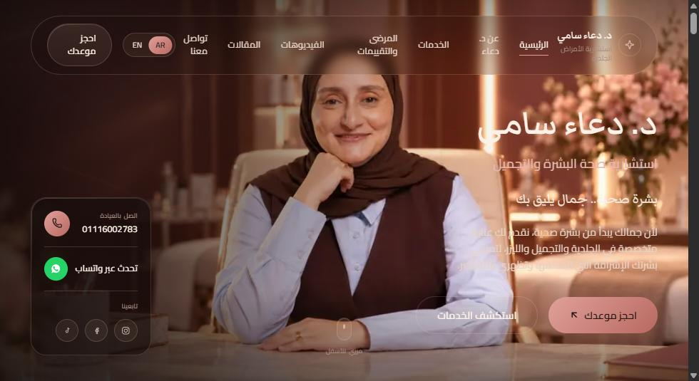
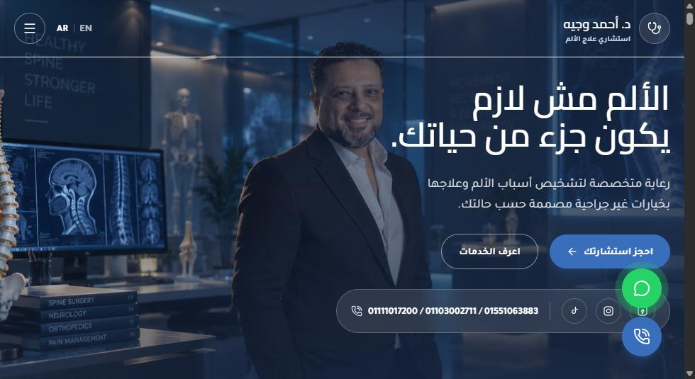
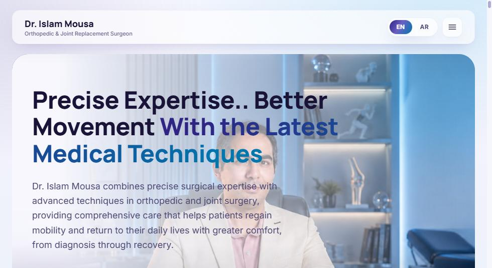
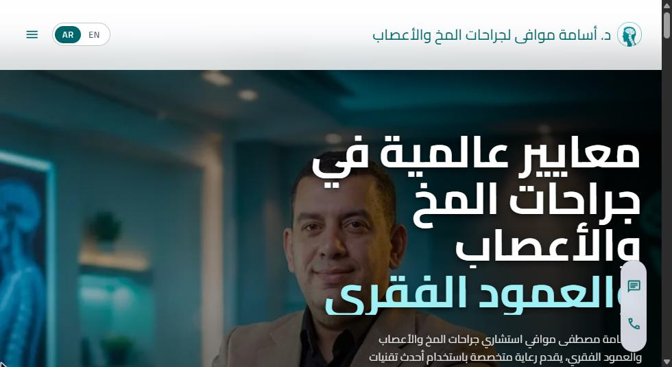
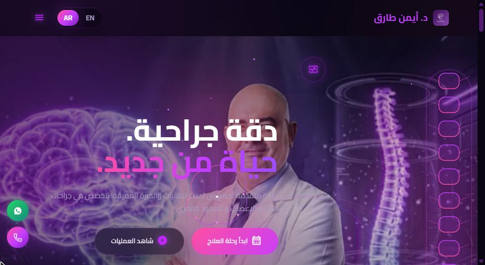
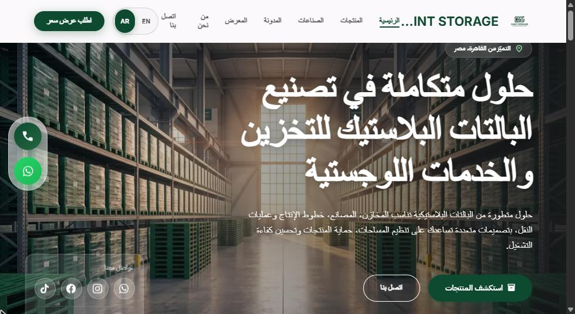

<h1 align="center">Hi, I'm Akram Tanany 👋</h1>
<h3 align="center">Full-Stack Web Developer — building fast, modern websites for doctors, clinics & businesses</h3>

  
  
  

  
  
  

---

### 🚀 About Me

- 💼 I design and build production-ready websites for medical clinics and businesses in Egypt and beyond
- 🌍 Multilingual (Arabic / English) sites with clean, responsive, mobile-first design
- ⚙️ Custom admin dashboards so clients can manage their own content — no code needed
- ⚡ Focused on performance, SEO, and a smooth user experience

### 🌐 Featured Client Websites

<table>
  <tr>
    <td width="50%" valign="top">
      
       <b><a href="https://dr-doaasamy.com/">Dr. Doaa Samy</a></b> — Dermatology & aesthetics clinic
       Next.js · TypeScript · Supabase · Custom admin CMS
    </td>
    <td width="50%" valign="top">
      
       <b><a href="https://dr-ahmedwagih.com/">Dr. Ahmed Wagih</a></b> — Pain management clinic
       Next.js · TypeScript · Prisma · Supabase · AR/EN
    </td>
  </tr>
  <tr>
    <td width="50%" valign="top">
      
       <b><a href="https://dr-islammousa.com/en">Dr. Islam Mousa</a></b> — Orthopedic & joint replacement surgeon
       Next.js · TypeScript · Framer Motion · Supabase · AR/EN
    </td>
    <td width="50%" valign="top">
      
       <b><a href="https://dr-osamamowafi.com/">Dr. Osama Mowafi</a></b> — Brain, nerves & spine surgeon
       Next.js · TypeScript · Framer Motion · Supabase · AR/EN
    </td>
  </tr>
  <tr>
    <td width="50%" valign="top">
      
       <b><a href="https://dr-aymantarek.com/">Dr. Ayman Tarek</a></b> — Neurosurgery & spine clinic
       Next.js · TypeScript · Framer Motion · Supabase · AR/EN
    </td>
    <td width="50%" valign="top">
      
       <b><a href="https://gaintstorage.com/">Gaint Storage</a></b> — Plastic pallets & logistics manufacturer
       Next.js · TypeScript · Supabase · AR/EN
    </td>
  </tr>
</table>

### 🛠️ Tech Stack

  
  
  
  
  
  
  
  
  
  
  
  

### 🎨 Frontend Projects

- **[Apple Vision](https://akkrrammm.github.io/Apple/)** — interactive Apple product landing page with parallax & AOS animations
- **[Aston Martin UI Clone](https://akkrrammm.github.io/Aston_Martin/)** — animated, responsive UI built with vanilla JS & GSAP

---

<h3 align="center">📫 Need a website for your clinic or business?</h3>

  I'm available for freelance projects — new websites, redesigns, landing pages and admin dashboards. 
  Let's talk about your project:

  
  
  

